# Building an Epic: A Visual Walkthrough

This walkthrough follows a single epic — **AM-700: Detail Panel Metadata Completeness** — from backlog to completion. It shows how AgileMaestro visualizes every stage of the development lifecycle as Claude Code's AI team builds, reviews, and ships a feature.

AM-700 contains 6 stories and 21 tasks. The goal: make every metadata field from the task schema visible in the detail panel UI, with dedicated views for bug and techdebt types.

---

## 1. Backlog

Everything starts here. The epic, its stories, and all tasks are `pending` — planned but not yet approved for work.

The tree sidebar shows the full hierarchy: the epic at the top, stories nested underneath, and tasks under each story. Every item has a pending status indicator.

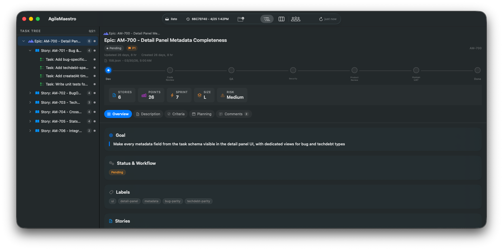

Clicking into a story reveals its metadata — points, sprint, labels, and the list of child tasks. All pending, waiting for approval.

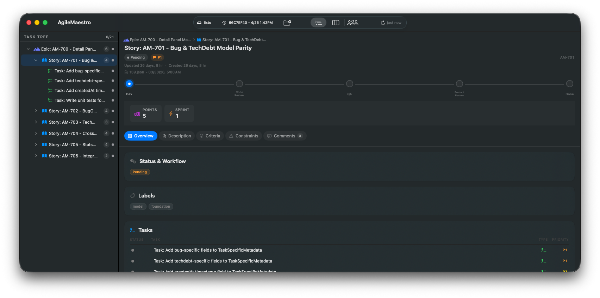

The Description tab shows the full story spec — the user story, context, technical approach, and dependencies. This is what the developer agent reads when it picks up the work.

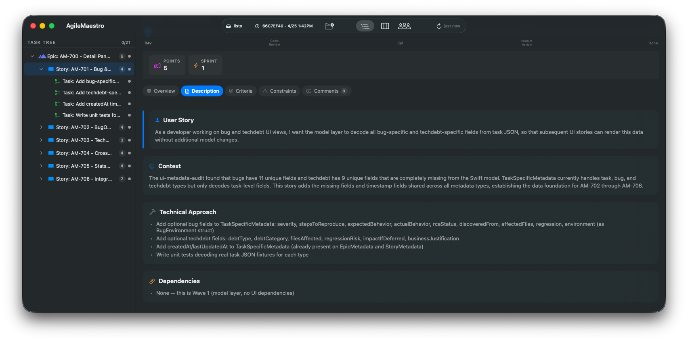

Back at the epic level, the Planning tab lays out the execution plan — the sequence of stories, what each one delivers, and how they depend on each other. The AI team uses this to determine build order.

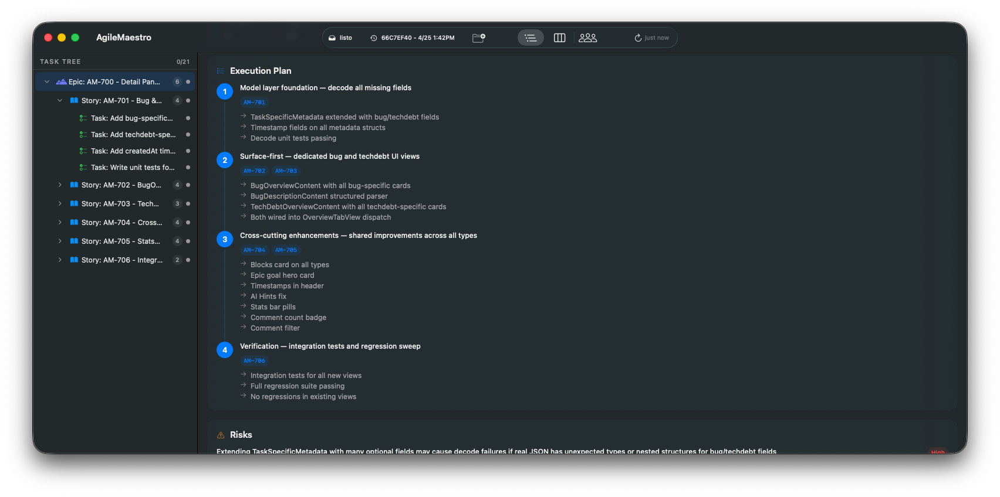

The Kanban board tells the same story from a different angle. Everything sits in the Backlog column. No work has started.

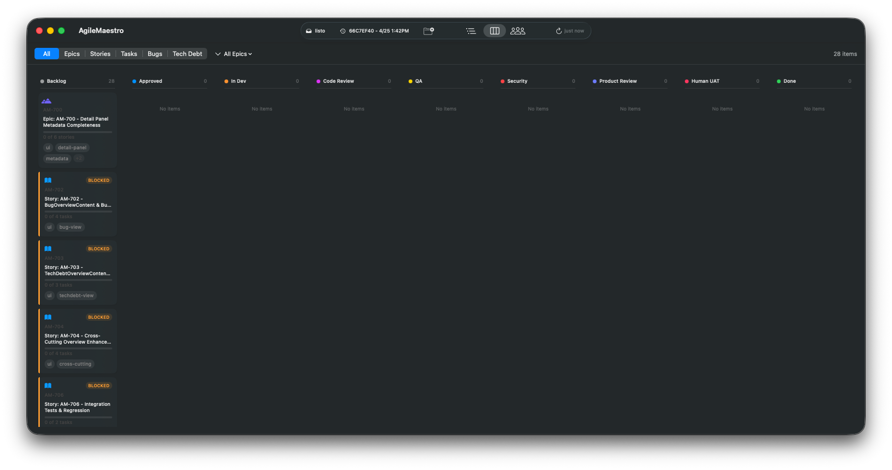

---

## 2. Approved

The human reviews the epic plan and approves it. Every item moves from `pending` approval to `approved` — signaling to the AI team that work can begin.

On the Kanban board, everything shifts from the Backlog column to the Approved column. The epic and its stories are ready to be claimed.

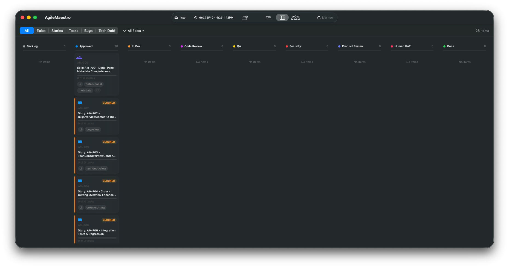

The tree view reflects the same state. The epic's workflow stepper shows the first stage (Dev) is next.

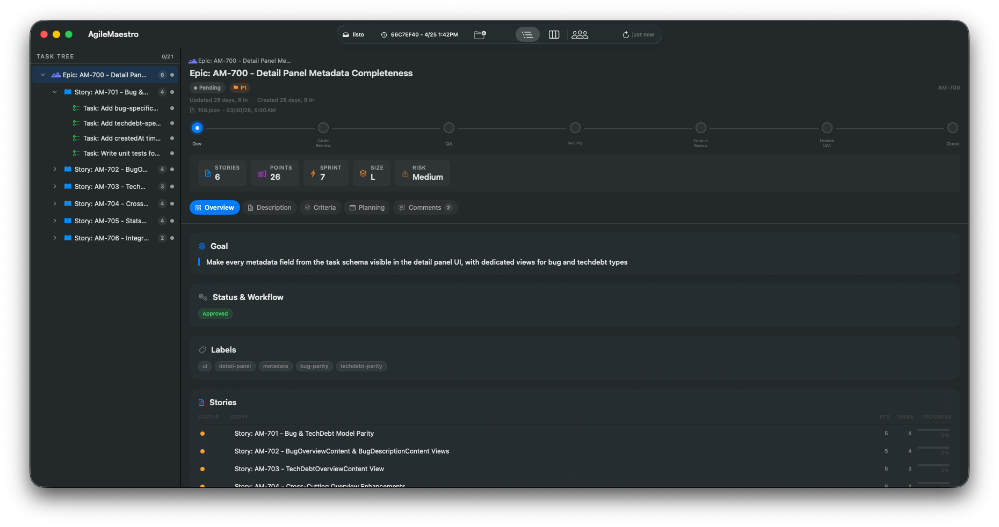

---

## 3. In Development

The coordinator starts the build. Story AM-701 (Bug & TechDebt Model Parity) is the first story in the execution plan — no dependencies, foundational work that other stories build on.

The macOS Developer agent claims the first task, implements it, writes tests, and commits. Then the next task. The story moves to `in_progress` only after its first task is claimed. Tasks in other stories stay `pending` — they haven't started.

The Kanban board shows the spread: the epic and Story AM-701 are in the In Dev column. Two tasks are already Done. One task is actively being worked on. The remaining stories wait in the Approved column.

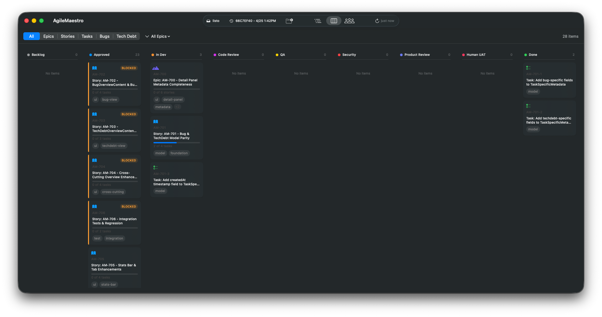

The tree view shows the same progression. The epic is `in_progress`, Story AM-701 is `in_progress` with a mix of completed and active tasks. Stories AM-702 through AM-706 are still pending.

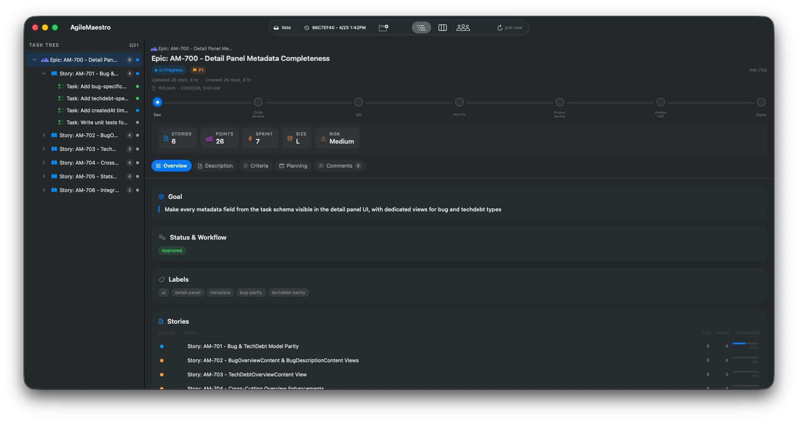

---

## 4. Code Review

All four tasks in Story AM-701 are complete. The story automatically advances to Code Review, where the Staff Engineer agent reviews all code changes across the story as a unit.

The story detail shows `Code Review` in the workflow stepper. The review checks architecture, standards compliance, and security. CodeRabbit runs in parallel as a second reviewer.

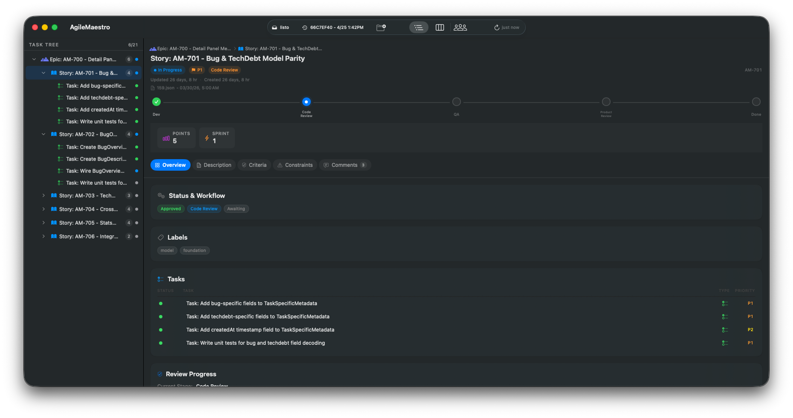

Meanwhile, Story AM-702 has started development — its first tasks are being claimed and built. The Kanban board shows the pipeline: AM-701 in Code Review, AM-702 in Dev, tasks flowing through.

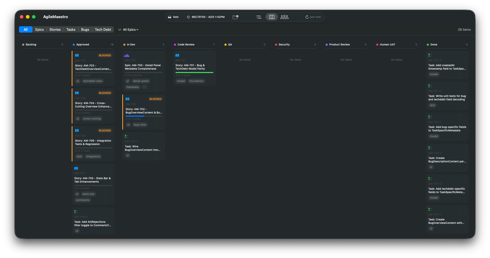

---

## 5. Security Review

Story AM-701 passed Code Review and QA. At the epic level, stories that pass QA advance to Security Review. Three security sub-agents run in parallel — static analysis, reasoning-based analysis, and platform-specific checks — reporting to a lead auditor who makes the pass/fail decision.

The Kanban board shows AM-701 in the Security column while development continues on other stories.

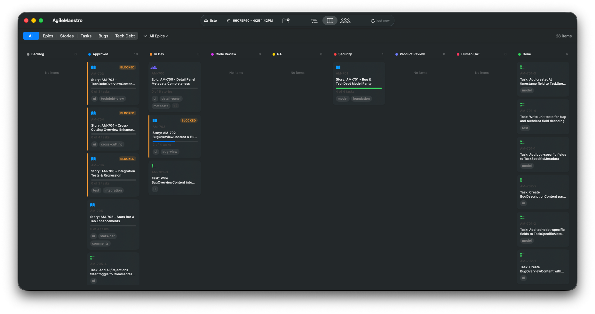

---

## 6. Human UAT

All six stories have passed through the full review cycle — Code Review, QA, Security, and Product Review. Every story is `completed`. Every task is `completed`.

The epic advances to Human UAT. This is the gate where the system stops and waits for a human to test the actual running application. No amount of automated testing replaces this step.

The workflow stepper on the epic detail shows Human UAT as the active stage — all prior stages are green.

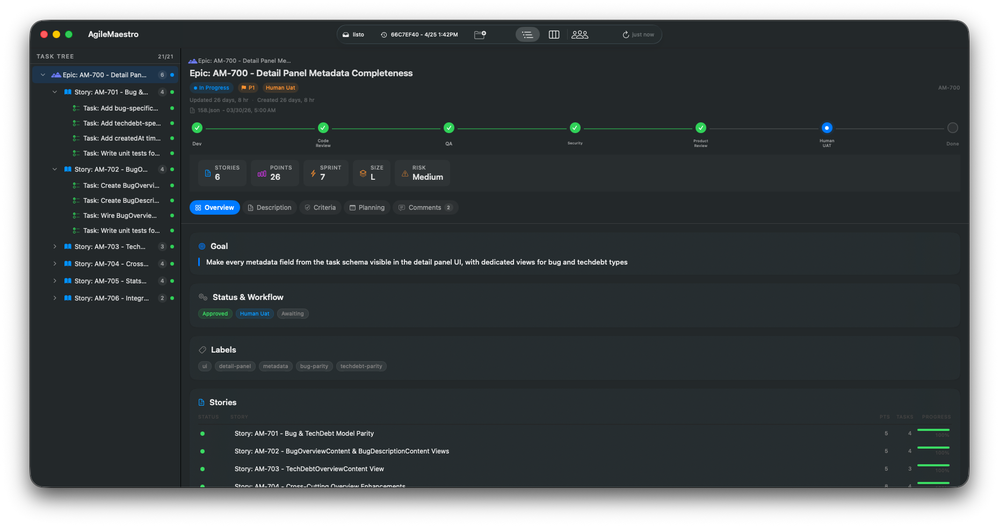

The Kanban board shows the epic sitting in the Human UAT column, with all stories and tasks in Done.

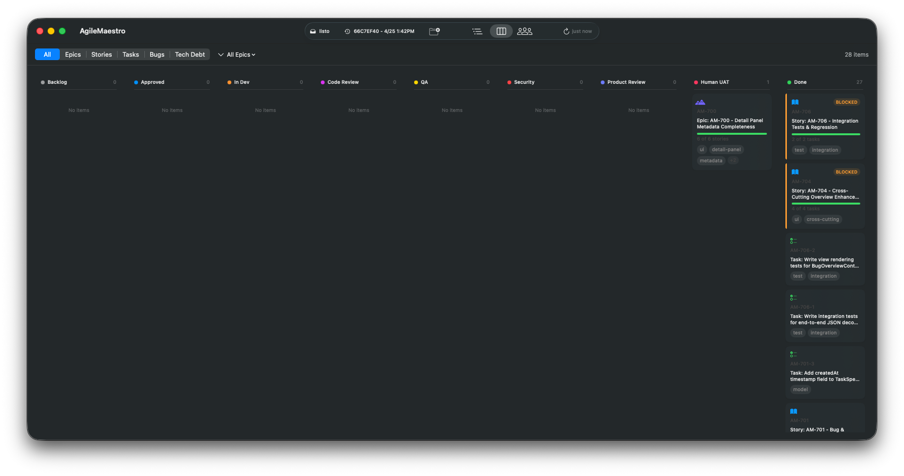

---

## 7. Done

The human tests the app, confirms everything works, and approves. The epic moves to `completed`. The entire workflow stepper is green.

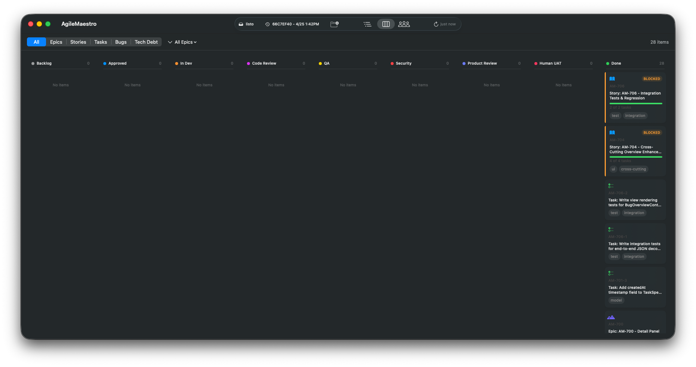

The epic detail shows the final state: completed, all stories shipped, all review gates passed.

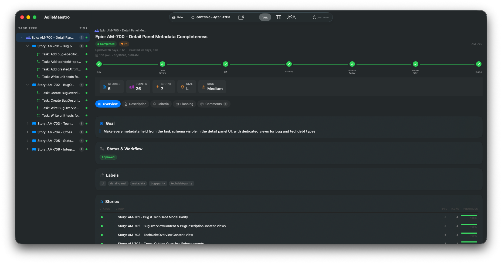

---

## The Pipeline

What you've seen is one epic moving through the system. In practice, multiple epics run concurrently. Stories within an epic build in dependency waves — independent stories run in parallel. The Kanban board shows the full pipeline state at a glance: what's being built, what's in review, what's waiting for a human.

The cycle for every piece of work:

```
Backlog -> Approved -> In Dev -> Code Review -> QA -> Security -> Product Review -> Human UAT -> Done
                         ^                                                            |
                         +----------------------- rejection at any stage -------------+
```

Any rejection at any stage sends work back to development, and the full review cycle restarts from Code Review. The system enforces this — there are no shortcuts.

This is what structured AI development looks like. Not one agent doing everything. A coordinated team, following a process, with quality gates that actually gate.

---

*Built with the [Claude Code Apple App Toolkit](https://github.com/productengineered/claude-code-apple-app-toolkit).*
